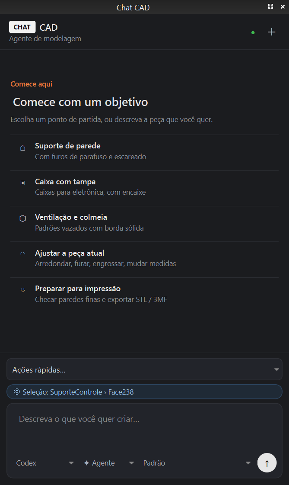
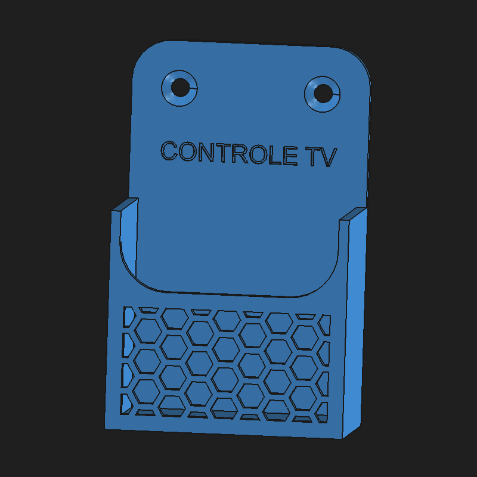

# Chat CAD for FreeCAD

An AI agent side panel for [FreeCAD](https://www.freecad.org/). Describe a part, point at a face, or scribble on the 3D view, and an agent (**Claude Code**, **OpenAI Codex** or **Google Antigravity**) models it for you, as a **parametric** FreeCAD document you can keep tweaking by hand.

> **Status: alpha.** Tested on Windows 11 with FreeCAD 1.1.4. Linux and macOS should work but are untested. The interface is currently in Brazilian Portuguese (translations welcome).

<p align="center">
  
  
  
</p>

## Features

- **Agent panel docked inside FreeCAD**, with a minimal dark UI, starting-point cards and quick actions. Toggle it with `Ctrl+Shift+Space`.
- **Pick your agent:** Claude Code, Codex or Antigravity, each with its own model list. Each uses **your existing CLI login/subscription**; no API keys are stored by the addon.
- **Point and ask:** whatever you select in the 3D view (faces, edges, picked points) is sent along with your message ("make a 5 mm hole *here*").
- **Draw what you mean:** capture the 3D view and scribble on it (pen, line, arrow, text, colors), start from a blank grid sheet, or paste/drag any image. All three agents read images.
- **Parametric by default:** the agents are instructed to keep every important dimension in a `Parametros` spreadsheet with aliases. Change a number and press `Ctrl+R`.
- **Safety nets:** a backup copy (`<name>.antes-<action>.FCStd`) is saved before each change; results are checked (valid single solid) and shown as a screenshot in the chat.
- **Agent / Plan modes:** *Agent* edits the model; *Plan* only discusses and proposes.

<p align="center"></p>

## How it works

```
FreeCAD ── Chat CAD panel ──(spawns headless CLI)──> claude -p / codex exec / agy -p
   ▲                                                         │
   └──── FreeCAD MCP addon (XML-RPC :9875) <── freecad-mcp MCP server (uvx)
```

The panel runs the agent CLI in headless mode, streams its JSON events into the chat, and gives it exactly one MCP server: [freecad-mcp](https://github.com/neka-nat/freecad-mcp), which drives the running FreeCAD instance.

## Requirements

1. **FreeCAD 1.0+** (tested with 1.1.4).
2. **[uv](https://docs.astral.sh/uv/)**, used to run the `freecad-mcp` server (`uvx`).
3. **The freecad-mcp FreeCAD addon** (the RPC side):
   copy `addon/FreeCADMCP` from [neka-nat/freecad-mcp](https://github.com/neka-nat/freecad-mcp) into your FreeCAD `Mod` folder, restart FreeCAD, switch to the **MCP Addon** workbench and enable **FreeCAD MCP → Auto-Start Server**.
4. **At least one agent CLI, logged in:**
   - [Claude Code](https://docs.claude.com/en/docs/claude-code): run `claude` once and `/login`.
   - [Codex CLI](https://github.com/openai/codex): `codex login`. The panel passes its MCP config on the command line; nothing to set up.
   - [Antigravity CLI](https://antigravity.google/docs/cli) (`agy`): log in once interactively, then register the MCP server and allow its tools (headless mode can't ask for permission):
     ```bash
     agy mcp add freecad -- uvx --python ">=3.12" freecad-mcp
     ```
     and in `~/.gemini/antigravity-cli/settings.json`:
     ```json
     { "permissions": { "allow": ["mcp(freecad/*)"] } }
     ```

The panel shows a **Connect** banner when the selected CLI is missing or logged out.

## Installation

**Option A: git clone into the Mod folder**

```bash
git clone https://github.com/Vittuu/freecad-chatcad.git
```

Clone it into your FreeCAD user `Mod` folder, for example `%APPDATA%\FreeCAD\v1-1\Mod\` on Windows or `~/.local/share/FreeCAD/v1-1/Mod/` on Linux. Then restart FreeCAD.

**Option B: Addon Manager custom repository**

Go to *Edit → Preferences → Addon Manager → Custom repositories*, add `https://github.com/Vittuu/freecad-chatcad` with branch `main`, then install **Chat CAD** from the Addon Manager.

## Tips

- Red to mark *where*, blue to mark *an area*, and write the dimensions on the drawing. Agents get it right on the first try much more often.
- Sending only an image works: the agent does what's marked on it.
- Speed varies a lot by agent and model. In our tests Claude and Codex answered simple edits in ~15–30 s; Antigravity took longer because it reads the tool schemas first.

## Security

The agents run **Python code inside your FreeCAD session** (through `freecad-mcp`'s `execute_code`) with your user's permissions. The panel limits what each CLI may do:

- **Claude Code:** only the `freecad` MCP server is loaded (`--strict-mcp-config`), and shell/edit/web tools are disallowed.
- **Codex:** runs with the `read-only` sandbox; only the `freecad` tools are pre-approved.
- **Antigravity:** only `mcp(freecad/*)` is allowed.

Still, review what you ask for, and keep backups of important files. The addon makes one before every change.

## Troubleshooting

- **The agent "writes" tool calls as text, or says the FreeCAD tools are unavailable.** The MCP server didn't start. FreeCAD puts its own Python (3.11) first on `PATH`, while `freecad-mcp` needs Python ≥ 3.12. The panel strips FreeCAD from `PATH` and calls `uvx --python ">=3.12"`. If it still fails, check `uvx freecad-mcp --help` in a terminal.
- **Log of the last turn:** `<FreeCAD user data>/chatcad_last.log`, for example `%APPDATA%\FreeCAD\v1-1\chatcad_last.log`.
- **Attachments** are stored in `<FreeCAD user data>/chatcad_anexos/`.

## Credits

- [freecad-mcp](https://github.com/neka-nat/freecad-mcp) by neka-nat: the FreeCAD MCP server this panel builds on.
- UI inspired by the agent sidebar of [OpenChatCut](https://github.com/0xsline/OpenChatCut).

## License

[LGPL-2.1](LICENSE), the same license as FreeCAD.

---

## 🇧🇷 Em português

**Chat CAD** é um painel de agente de IA dentro do FreeCAD. Você descreve a peça, clica numa face ou rabisca na vista 3D, e o agente (Claude Code, Codex ou Antigravity) modela para você, sempre de forma **paramétrica**: as medidas ficam numa planilha `Parametros`, que você ajusta e atualiza com `Ctrl+R`.

**Para usar:**

1. Instale o FreeCAD 1.0+, o [uv](https://docs.astral.sh/uv/) e o complemento do [freecad-mcp](https://github.com/neka-nat/freecad-mcp). No FreeCAD, ligue *FreeCAD MCP → Auto-Start Server*.
2. Instale e faça login em pelo menos uma IA: `claude` (/login), `codex login` ou `agy`. O Antigravity precisa dos dois passos extras da seção *Requirements* acima.
3. Clone este repositório na pasta `Mod` do FreeCAD e reinicie o FreeCAD. O painel abre à esquerda (`Ctrl+Shift+Espaço` mostra e esconde).

**Recursos:** escolha da IA e do modelo; a seleção feita no FreeCAD vai junto com a mensagem; desenho por cima da vista 3D, folha em branco ou imagens coladas; modos Agente e Planejar; backup automático antes de cada mudança.

Testado no Windows 11 com o FreeCAD 1.1.4. Ainda é uma versão alfa: relatos de bugs e contribuições são bem-vindos!
